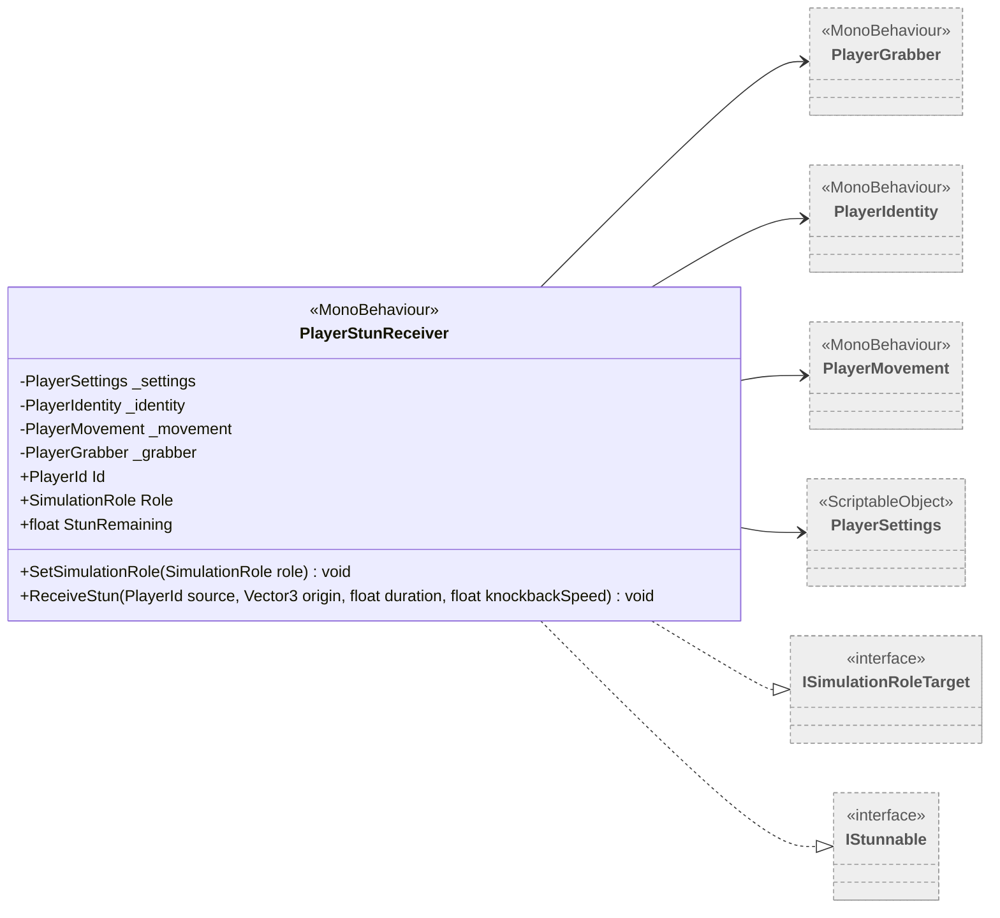

# PlayerStunReceiver

> Blast target on the player root: drops whatever is carried (thrown away from the blast), knocks the player back and stuns it. Stuns never stack: the longest remaining one wins (`PlayerMovement.ApplyKnockback`). As a `SimulationRole.Replica` blasts are ignored (the authority applies them).

**Módulo:** [[Modulo Player|Player]] · **Namespace:** `AlienFarms.Player` · **Archivo:** `Assets/Scripts/Player/PlayerStunReceiver.cs`

## Hereda / implementa
`MonoBehaviour`, [[IStunnable]], [[ISimulationRoleTarget]]

## Diagrama

## Usa
[[DropReason]], [[GameEvents]], [[ISimulationRoleTarget]], [[IStunnable]], [[PlanarMath]], [[PlayerGrabber]], [[PlayerId]], [[PlayerIdentity]], [[PlayerMovement]], [[PlayerSettings]], [[SimulationRole]]

## Usado por
[[PlayerRig]]

## Eventos que publica
[[Eventos GameEvents#OnPlayerStunned|OnPlayerStunned]]
