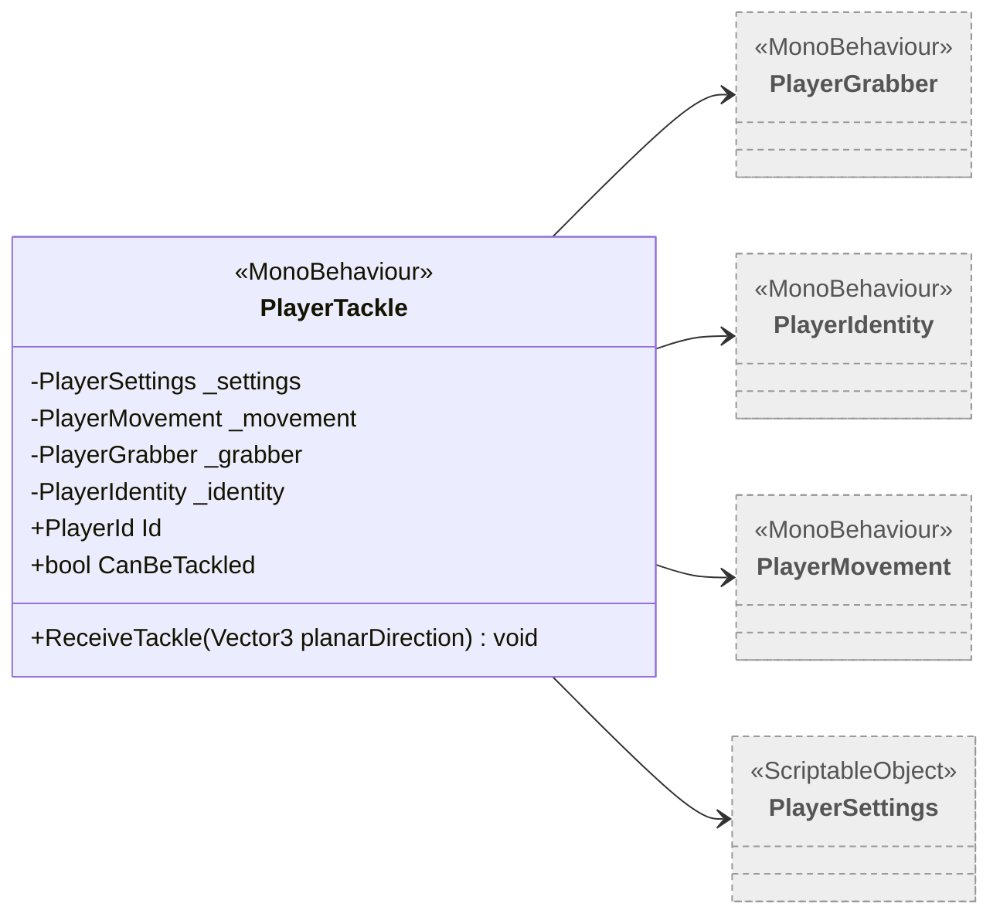

# PlayerTackle

> Stealing by tackle: a sprinting player that runs into a carrier (fast enough and facing it) makes the carrier drop its animal, get knocked back and briefly stunned. Evaluated on the attacker's side of the collision.

**Módulo:** [[Modulo Player|Player]] · **Namespace:** `AlienFarms.Player` · **Archivo:** `Assets/Scripts/Player/PlayerTackle.cs`

## Hereda / implementa
`MonoBehaviour`

## Diagrama

## Usa
[[DropReason]], [[LayerNames]], [[PlayerGrabber]], [[PlayerId]], [[PlayerIdentity]], [[PlayerMovement]], [[PlayerSettings]]

## Usado por
[[PlayerRig]]
