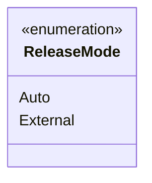

# ReleaseMode

> Who decides when a `PlayerGrabber` lets go of what it carries.

**Módulo:** [[Modulo Player|Player]] · **Namespace:** `AlienFarms.Player` · **Archivo:** `Assets/Scripts/Player/ReleaseMode.cs`

## Diagrama

## Valores
`Auto`, `External`

## Usado por
[[Mode]], [[NetworkCarry]], [[PlayerGrabber]]
