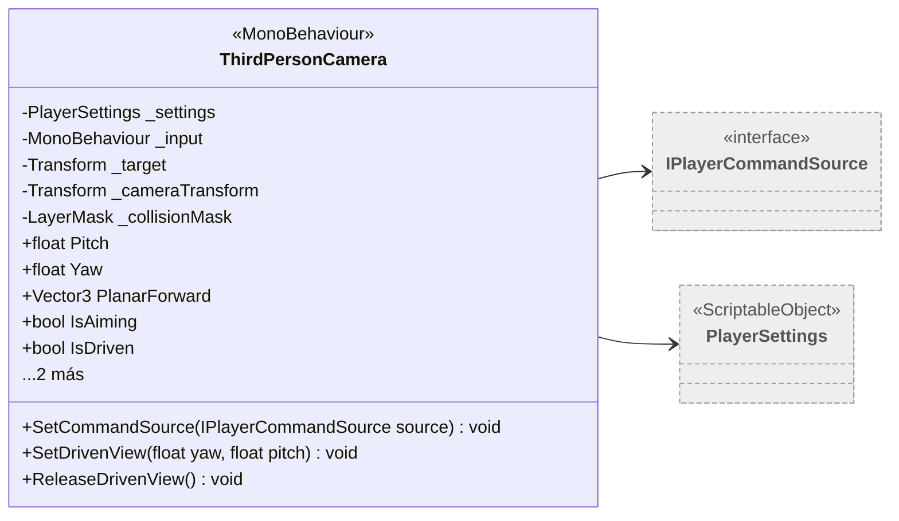

# ThirdPersonCamera

> Orbit camera rig driven by this player's Look input. Lives on the CameraRig (child of the non-rotating player root); the camera is a child placed at local (0, 0, -distance). While aiming, the distance blends to the aim distance and look sensitivity is reduced. In driven mode (`SetDrivenView`) yaw and pitch come from outside and the Look input is ignored.

**Módulo:** [[Modulo Player|Player]] · **Namespace:** `AlienFarms.Player` · **Archivo:** `Assets/Scripts/Player/ThirdPersonCamera.cs`

## Hereda / implementa
`MonoBehaviour`

## Diagrama

## Usa
[[Animal]], [[IPlayerCommandSource]], [[LayerNames]], [[PlayerSettings]]

## Usado por
[[Mode]], [[NetworkCarry]], [[NetworkPlayer]], [[NetworkPlayerInput]], [[PlayerAim]], [[PlayerRig]]
