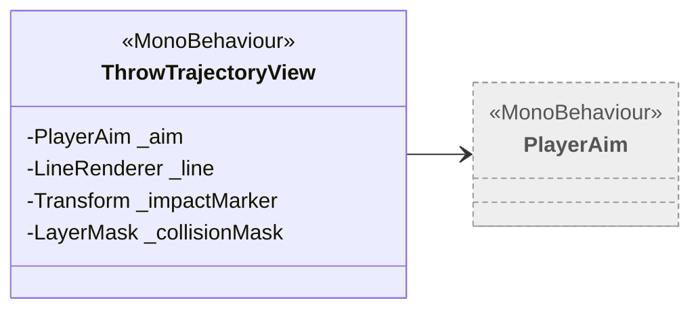

# ThrowTrajectoryView

> Draws the throw arc while aiming. Simulates with the same integrator and step as PhysX (`BallisticMath.Step`, Time.fixedDeltaTime, Physics.gravity), so the preview matches the real flight of an undamped body. The arc follows the BASE of the carried body and sweeps a sphere of its size resting on that base, so it stops where the body touches Ground/Environment: the same spot where the animal lands (its horizontal momentum is removed on landing). Runs after the camera's LateUpdate to use this frame's pitch and yaw.

**Módulo:** [[Modulo Player|Player]] · **Namespace:** `AlienFarms.Player` · **Archivo:** `Assets/Scripts/Player/ThrowTrajectoryView.cs`

## Hereda / implementa
`MonoBehaviour`

## Diagrama

## Usa
[[Animal]], [[BallisticMath]], [[IThrowable]], [[LayerNames]], [[PlayerAim]], [[ThrowSettings]]
