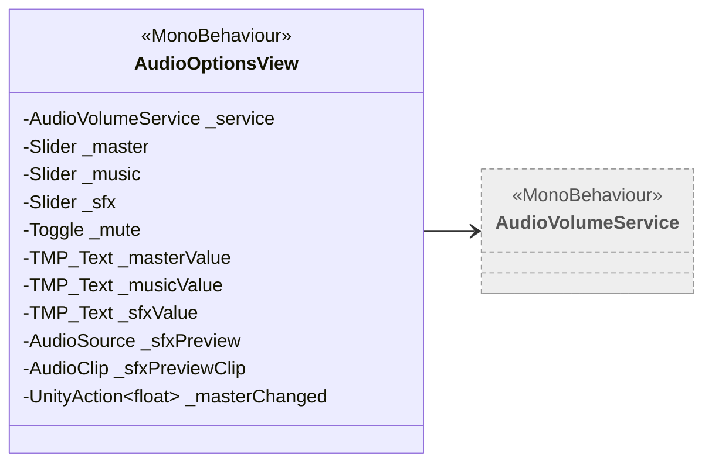

# AudioOptionsView

> Audio options panel: Master/Music/SFX sliders (linear 0..1), optional mute toggle, percentage labels and SFX preview. Reads the service when shown, writes on every change and saves when hidden. Lives on the panel root.

**Módulo:** [[Modulo UI|UI]] · **Namespace:** `AlienFarms.UI` · **Archivo:** `Assets/Scripts/UI/AudioOptionsView.cs`

## Hereda / implementa
`MonoBehaviour`

## Diagrama

## Usa
[[AudioVolumeService]], [[VolumeChannel]]
