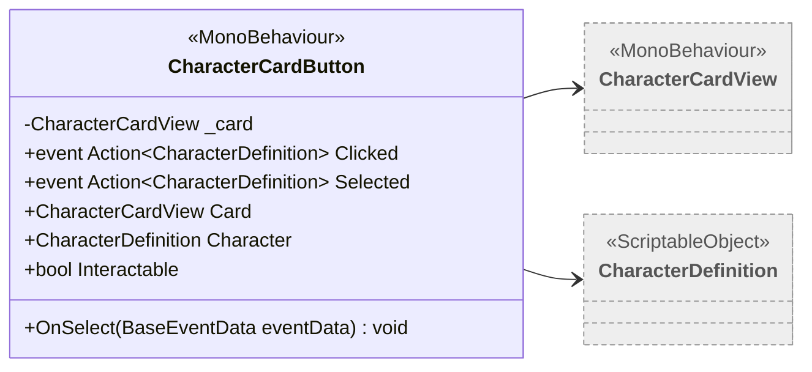

# CharacterCardButton

> Makes a `CharacterCardView` a navigable button (online room): selecting it reports the hovered character and clicking (Submit) reports the pick. The card itself still renders cursors and locks.

**Módulo:** [[Modulo UI|UI]] · **Namespace:** `AlienFarms.UI` · **Archivo:** `Assets/Scripts/UI/CharacterCardButton.cs`

## Hereda / implementa
`MonoBehaviour`, `ISelectHandler`

## Diagrama

## Usa
[[CharacterCardView]], [[CharacterDefinition]]

## Usado por
[[OnlinePanelView]]
