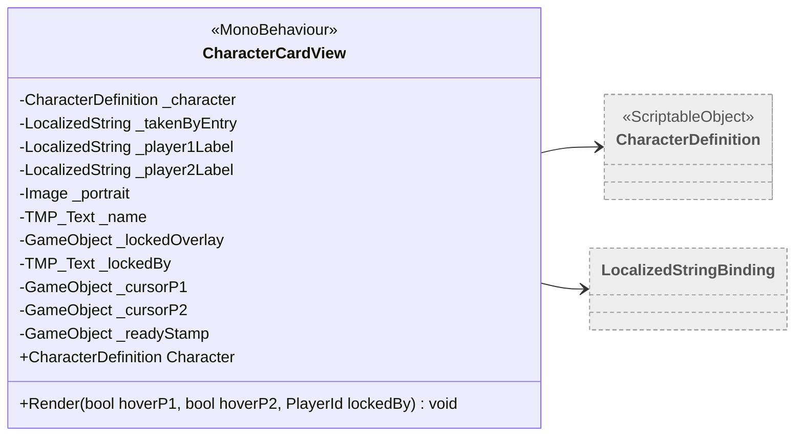

# CharacterCardView

> One character card on the select screen: portrait and name of its character, which players hover it and who locked it. Rendered by `CharacterSelectView` after each selection change (not per frame).

**Módulo:** [[Modulo UI|UI]] · **Namespace:** `AlienFarms.UI` · **Archivo:** `Assets/Scripts/UI/CharacterCardView.cs`

## Hereda / implementa
`MonoBehaviour`

## Diagrama

## Usa
[[CharacterDefinition]], [[LocalizationKeys]], [[LocalizedStringBinding]], [[PlayerId]]

## Usado por
[[CharacterSelectView]]
