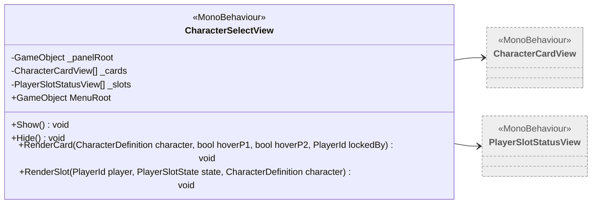

# CharacterSelectView

> Character select panel: forwards per-character and per-player state to its cards and slots. Driven by the menu flow after each selection change. Lives on an always-active object and toggles `_panelRoot`.

**Módulo:** [[Modulo UI|UI]] · **Namespace:** `AlienFarms.UI` · **Archivo:** `Assets/Scripts/UI/CharacterSelectView.cs`

## Hereda / implementa
`MonoBehaviour`

## Diagrama

## Usa
[[CharacterCardView]], [[CharacterDefinition]], [[PlayerId]], [[PlayerSlotState]], [[PlayerSlotStatusView]]

## Usado por
[[MenuFlowController]]
