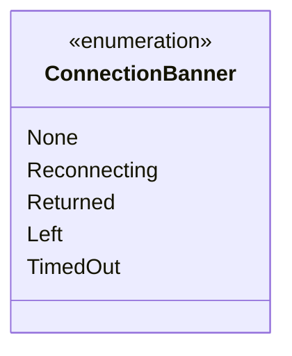

# ConnectionBanner

> What the HUD connection banner shows for a seat (`ConnectionStatusRules.Resolve`).

**Módulo:** [[Modulo UI|UI]] · **Namespace:** `AlienFarms.UI` · **Archivo:** `Assets/Scripts/UI/ConnectionBanner.cs`

## Diagrama

## Valores
`None`, `Reconnecting`, `Returned`, `Left`, `TimedOut`

## Usado por
[[ConnectionStatusRules]], [[ConnectionStatusView]]
