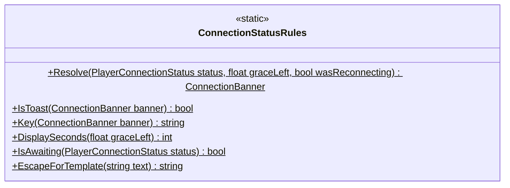

# ConnectionStatusRules

> Pure rules of `ConnectionStatusView`: which banner a seat's `PlayerConnectionStatus` shows, which localization key it uses and how the grace countdown is displayed. No allocation.

**Módulo:** [[Modulo UI|UI]] · **Namespace:** `AlienFarms.UI` · **Archivo:** `Assets/Scripts/UI/ConnectionStatusRules.cs`

## Diagrama

## Usa
[[ConnectionBanner]], [[LocalizationKeys]], [[PlayerConnectionStatus]]

## Usado por
[[ConnectionStatusView]]
