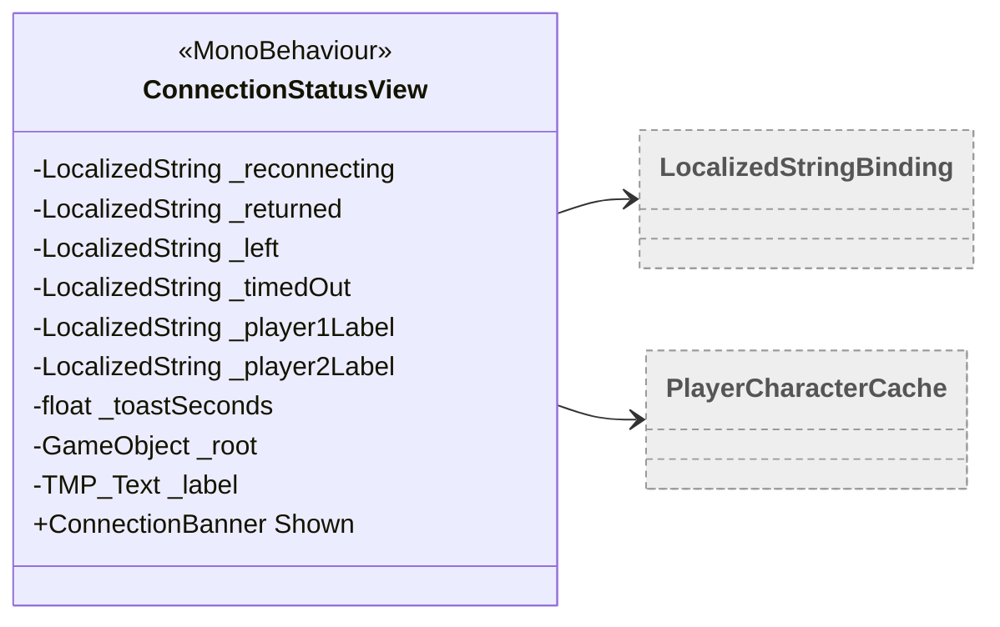

# ConnectionStatusView

> HUD connection banner (online). Listens to `GameEvents.OnPlayerConnectionChanged`: Reconnecting: "Waiting for P2 · {character}: n s", counted down locally on unscaled time. The template is built once per state change and the number is written with SetText(format, float) only when the whole second changes (no allocation per frame). Left / TimedOut / back after a drop: a toast that hides after `_toastSeconds`, then the banner returns to any seat that is still reserved. Character names come from `GameEvents.OnPlayerCharacterAssigned` (kept after the avatar despawns). Lives on an always-active object and toggles `_root`.

**Módulo:** [[Modulo UI|UI]] · **Namespace:** `AlienFarms.UI` · **Archivo:** `Assets/Scripts/UI/ConnectionStatusView.cs`

## Hereda / implementa
`MonoBehaviour`

## Diagrama

## Usa
[[CharacterDefinition]], [[ConnectionBanner]], [[ConnectionStatusRules]], [[GameEvents]], [[LocalizationKeys]], [[LocalizedStringBinding]], [[PlayerCharacterCache]], [[PlayerConnectionStatus]], [[PlayerId]]

## Eventos que escucha
[[Eventos GameEvents#OnPlayerCharacterAssigned|OnPlayerCharacterAssigned]], [[Eventos GameEvents#OnPlayerConnectionChanged|OnPlayerConnectionChanged]]
