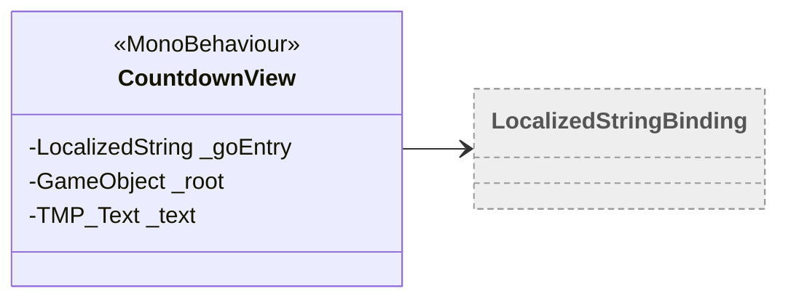

# CountdownView

> Shows the pre-round countdown ("3", "2", "1") and a short "GO" message when play starts. The GO duration comes with `GameEvents.OnCountdownFinished` (single source: the match settings). Lives on an always-active object and toggles `_root`.

**Módulo:** [[Modulo UI|UI]] · **Namespace:** `AlienFarms.UI` · **Archivo:** `Assets/Scripts/UI/CountdownView.cs`

## Hereda / implementa
`MonoBehaviour`

## Diagrama

## Usa
[[GameEvents]], [[LocalizationKeys]], [[LocalizedStringBinding]], [[MatchPhase]]

## Eventos que escucha
[[Eventos GameEvents#OnCountdownFinished|OnCountdownFinished]], [[Eventos GameEvents#OnCountdownTick|OnCountdownTick]], [[Eventos GameEvents#OnMatchPhaseChanged|OnMatchPhaseChanged]]
