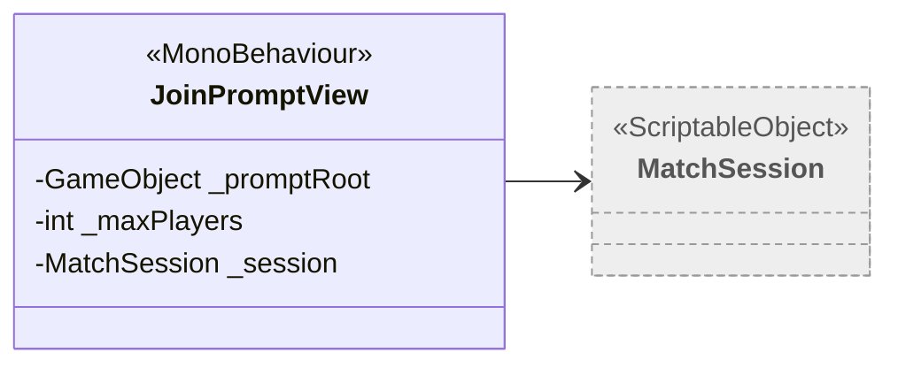

# JoinPromptView

> Shows the "press a button to join" prompt while the lobby is not full. When a MainMenu session is ready the players join by themselves at Start, so the prompt stays hidden for the first frame and only shows afterwards if a session player could not be joined.

**Módulo:** [[Modulo UI|UI]] · **Namespace:** `AlienFarms.UI` · **Archivo:** `Assets/Scripts/UI/JoinPromptView.cs`

## Hereda / implementa
`MonoBehaviour`

## Diagrama

## Usa
[[GameEvents]], [[MatchSession]], [[PlayerId]]

## Eventos que escucha
[[Eventos GameEvents#OnPlayerJoined|OnPlayerJoined]], [[Eventos GameEvents#OnPlayerLeft|OnPlayerLeft]]
