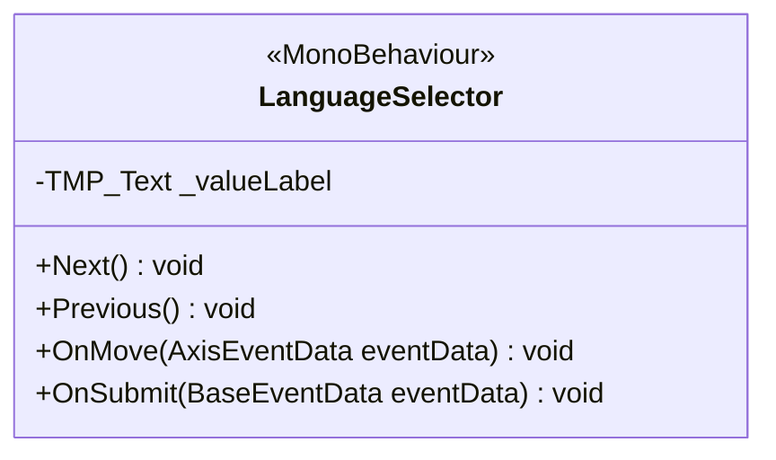

# LanguageSelector

> Options row that cycles the game language. Left/Right (stick, arrows) and Submit change the locale; Up/Down navigation stays with the Selectable (Explicit, left/right empty). Arrow buttons call `Previous` / `Next` from their onClick. The choice is global and persisted by the PlayerPrefs startup selector.

**Módulo:** [[Modulo UI|UI]] · **Namespace:** `AlienFarms.UI` · **Archivo:** `Assets/Scripts/UI/LanguageSelector.cs`

## Hereda / implementa
`MonoBehaviour`, `IMoveHandler`, `ISubmitHandler`

## Diagrama

## Usa
[[LocaleCycle]]
