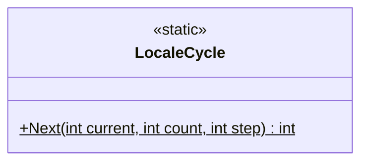

# LocaleCycle

> Index math for cycling through a list of locales with wrap-around.

**Módulo:** [[Modulo UI|UI]] · **Namespace:** `AlienFarms.UI` · **Archivo:** `Assets/Scripts/UI/LocaleCycle.cs`

## Diagrama

## Usado por
[[LanguageSelector]]
