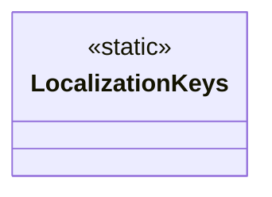

# LocalizationKeys

> String Table Collection names and entry keys. Code-driven texts use these as LocalizedString defaults; the editor setup tool seeds every key listed here.

**Módulo:** [[Modulo UI|UI]] · **Namespace:** `AlienFarms.UI` · **Archivo:** `Assets/Scripts/UI/LocalizationKeys.cs`

## Diagrama

## Usado por
[[CharacterCardView]], [[CountdownView]], [[LocalizationSeedData]], [[LocalizationSetupMenu]], [[MatchResultsView]], [[PauseMenuView]], [[PlayerSlotStatusView]]
