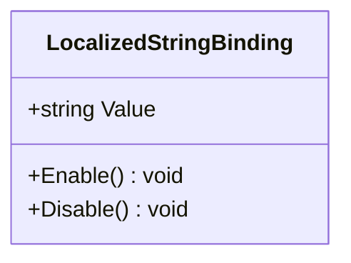

# LocalizedStringBinding

> Keeps the resolved value of a `LocalizedString` and notifies when it changes (load or locale change). `Value` stays null until the string resolves: callers must then leave the scene text untouched. Call `Enable` from OnEnable and `Disable` from OnDisable.

**Módulo:** [[Modulo UI|UI]] · **Namespace:** `AlienFarms.UI` · **Archivo:** `Assets/Scripts/UI/LocalizedStringBinding.cs`

## Diagrama

## Usado por
[[CharacterCardView]], [[CountdownView]], [[MatchResultsView]], [[PauseMenuView]], [[PlayerSlotStatusView]]
