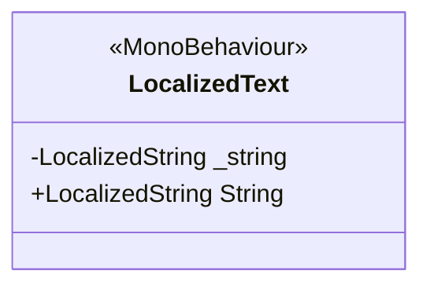

# LocalizedText

> Writes a localized string into the TMP text on this object and refreshes it when the locale changes. Only for static texts: never put it on a text that a view writes from code.

**Módulo:** [[Modulo UI|UI]] · **Namespace:** `AlienFarms.UI` · **Archivo:** `Assets/Scripts/UI/LocalizedText.cs`

## Hereda / implementa
`MonoBehaviour`

## Diagrama

## Usado por
[[LocalizationSetupMenu]], [[ViewDrivenTextCollector]]
