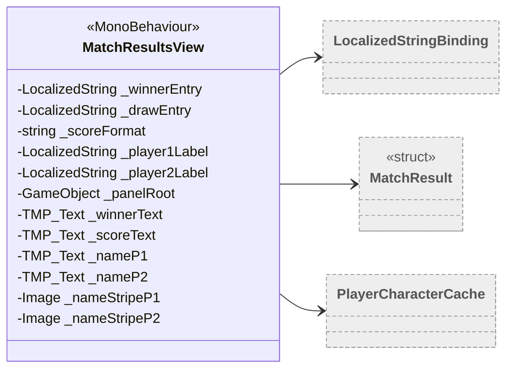

# MatchResultsView

> Shows the round result (winner by character name, both names and the score) while the match is in Results. The winner text is tinted with the winner's Theme.Secondary; names use the dark Theme.Accent (readable on the cream wood panel) and optional stripes under them carry Theme.Secondary. Lives on an always-active object and toggles `_panelRoot`. Buttons (rematch, title) are wired in the scene; the menu owner is set by ResultsMenuController.

**Módulo:** [[Modulo UI|UI]] · **Namespace:** `AlienFarms.UI` · **Archivo:** `Assets/Scripts/UI/MatchResultsView.cs`

## Hereda / implementa
`MonoBehaviour`

## Diagrama

## Usa
[[CharacterDefinition]], [[GameEvents]], [[LocalizationKeys]], [[LocalizedStringBinding]], [[MatchPhase]], [[MatchResult]], [[PlayerCharacterCache]], [[PlayerId]]

## Eventos que escucha
[[Eventos GameEvents#OnMatchEnded|OnMatchEnded]], [[Eventos GameEvents#OnMatchPhaseChanged|OnMatchPhaseChanged]], [[Eventos GameEvents#OnPlayerCharacterAssigned|OnPlayerCharacterAssigned]]
