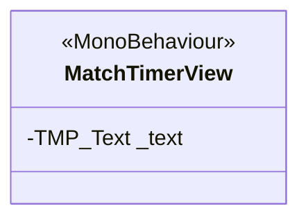

# MatchTimerView

> Shows the remaining round time as "m:ss". Updated only when the whole second changes (no per-frame work).

**Módulo:** [[Modulo UI|UI]] · **Namespace:** `AlienFarms.UI` · **Archivo:** `Assets/Scripts/UI/MatchTimerView.cs`

## Hereda / implementa
`MonoBehaviour`

## Diagrama

## Usa
[[GameEvents]], [[TimeFormat]]

## Eventos que escucha
[[Eventos GameEvents#OnMatchTimeChanged|OnMatchTimeChanged]]
