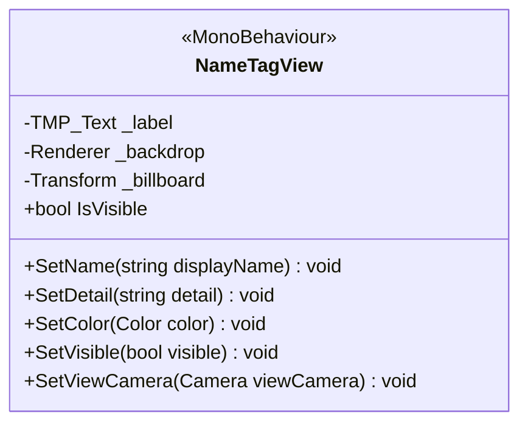

# NameTagView

> World-space name tag over an avatar with a TextMeshPro 3D label, an optional debug line, and an optional backdrop. A driver (e.g. the online NetworkNameTag) feeds it. The text is rebuilt only when the name or the detail changes; while visible it faces the assigned camera in LateUpdate (parallel to the view plane, no allocation). Lives on the tag's own child, never on the avatar root (the billboard rotates this transform).

**Módulo:** [[Modulo UI|UI]] · **Namespace:** `AlienFarms.UI` · **Archivo:** `Assets/Scripts/UI/NameTagView.cs`

## Hereda / implementa
`MonoBehaviour`

## Diagrama

## Usado por
[[NetworkNameTag]]
