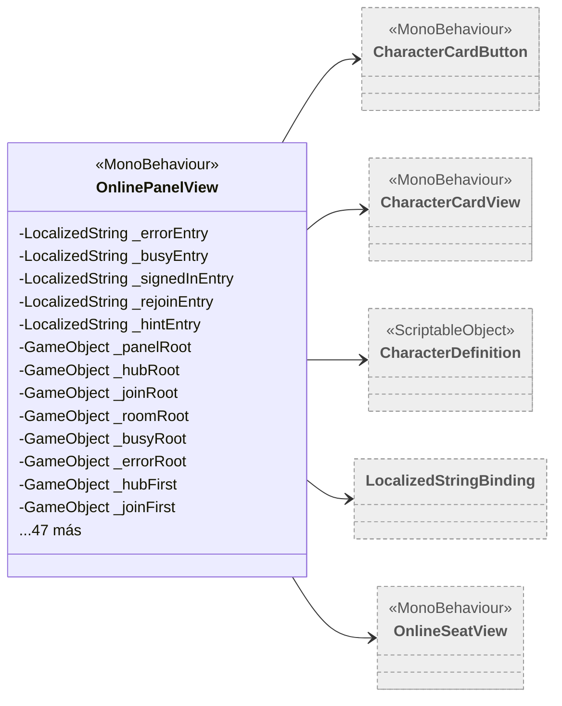

# OnlinePanelView

> Online panel (hub, join, room, busy) of the MainMenu. Pure view: everything lives in the scene and is referenced here; `OnlineMenuController` drives it on channel changes (never per frame). Lives on an always-active object and toggles `_panelRoot`. Dynamic texts (error, busy label, hint) swap the entry of a `LocalizedString`; their text arrives through StringChanged, so strings are only built on changes.

**Módulo:** [[Modulo UI|UI]] · **Namespace:** `AlienFarms.UI` · **Archivo:** `Assets/Scripts/UI/OnlinePanelView.cs`

## Hereda / implementa
`MonoBehaviour`

## Diagrama

## Usa
[[CharacterCardButton]], [[CharacterCardView]], [[CharacterDefinition]], [[DisplayNameSanitizer]], [[LocalizationKeys]], [[LocalizedStringBinding]], [[LocalizedText]], [[Mode]], [[OnlineLobbyChannel]], [[OnlineLobbySeat]], [[OnlineScreen]], [[OnlineSeatView]], [[PlayerId]]

## Usado por
[[OnlineMenuController]]
