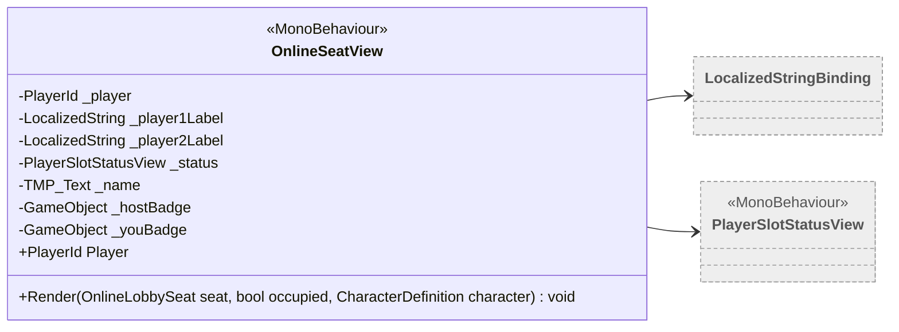

# OnlineSeatView

> One player seat of the online room: reuses `PlayerSlotStatusView` for the status ("waiting for a player" / "choosing" / "ready") and adds the player's name and the host / you badges. Rendered on lobby changes.

**Módulo:** [[Modulo UI|UI]] · **Namespace:** `AlienFarms.UI` · **Archivo:** `Assets/Scripts/UI/OnlineSeatView.cs`

## Hereda / implementa
`MonoBehaviour`

## Diagrama

## Usa
[[CharacterDefinition]], [[LocalizationKeys]], [[LocalizedStringBinding]], [[OnlineLobbySeat]], [[PlayerId]], [[PlayerSlotState]], [[PlayerSlotStatusView]]

## Usado por
[[OnlinePanelView]]
