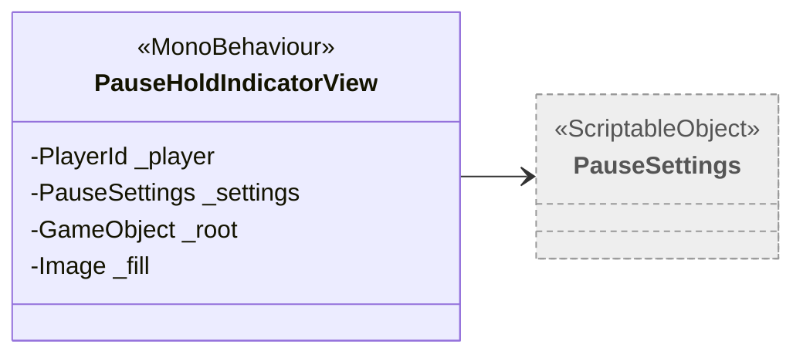

# PauseHoldIndicatorView

> Shows one player's hold-to-pause progress as a filled bar. Appears only after holding for `PauseSettings.ShowProgressAfter`, never while paused or in a phase that cannot pause. Lives on an always-active object and toggles `_root`.

**Módulo:** [[Modulo UI|UI]] · **Namespace:** `AlienFarms.UI` · **Archivo:** `Assets/Scripts/UI/PauseHoldIndicatorView.cs`

## Hereda / implementa
`MonoBehaviour`

## Diagrama

## Usa
[[GameEvents]], [[MatchPhase]], [[PauseRules]], [[PauseSettings]], [[PlayerId]]

## Eventos que escucha
[[Eventos GameEvents#OnGamePaused|OnGamePaused]], [[Eventos GameEvents#OnGameResumed|OnGameResumed]], [[Eventos GameEvents#OnMatchPhaseChanged|OnMatchPhaseChanged]], [[Eventos GameEvents#OnPauseHoldProgress|OnPauseHoldProgress]]
