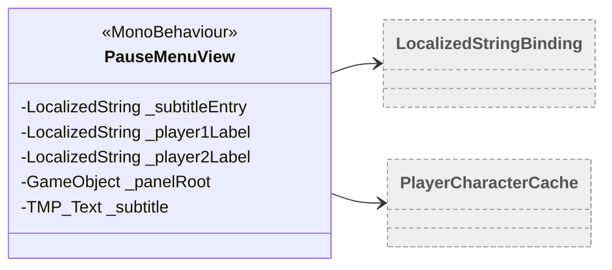

# PauseMenuView

> Shows the pause panel while the game is paused, with a subtitle naming who paused. Lives on an always-active object and toggles `_panelRoot`. Buttons are wired to PauseController in the scene.

**Módulo:** [[Modulo UI|UI]] · **Namespace:** `AlienFarms.UI` · **Archivo:** `Assets/Scripts/UI/PauseMenuView.cs`

## Hereda / implementa
`MonoBehaviour`

## Diagrama

## Usa
[[CharacterDefinition]], [[GameEvents]], [[LocalizationKeys]], [[LocalizedStringBinding]], [[PlayerCharacterCache]], [[PlayerId]]

## Eventos que escucha
[[Eventos GameEvents#OnGamePaused|OnGamePaused]], [[Eventos GameEvents#OnGameResumed|OnGameResumed]], [[Eventos GameEvents#OnPlayerCharacterAssigned|OnPlayerCharacterAssigned]]
