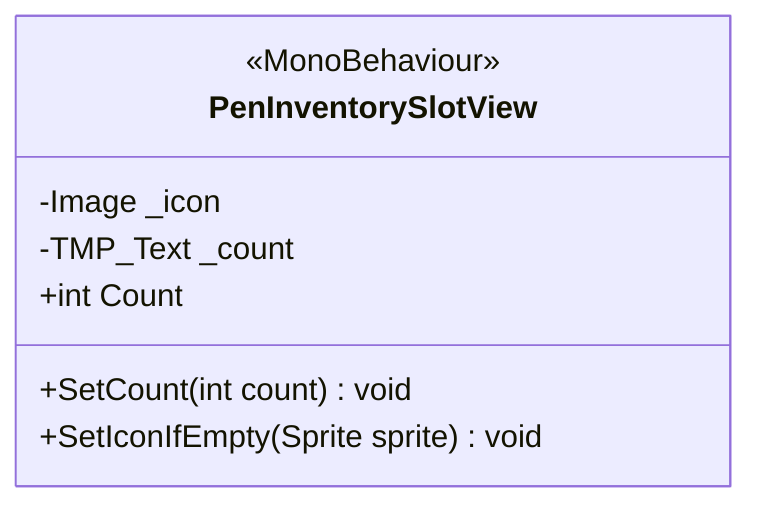

# PenInventorySlotView

> One animal type in a pen inventory HUD: icon plus count. Driven by `PenInventoryView`.

**Módulo:** [[Modulo UI|UI]] · **Namespace:** `AlienFarms.UI` · **Archivo:** `Assets/Scripts/UI/PenInventorySlotView.cs`

## Hereda / implementa
`MonoBehaviour`

## Diagrama

## Usado por
[[PenInventoryView]]
