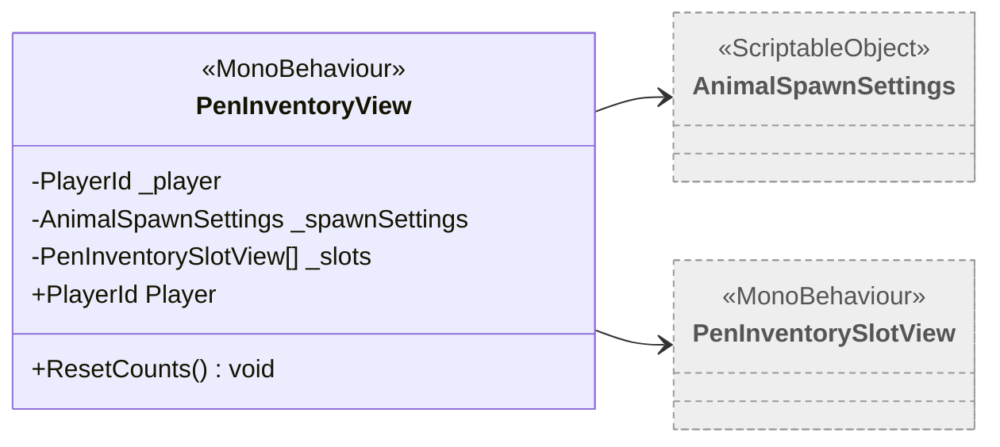

# PenInventoryView

> Shows one player's pen inventory (count per animal type). Driven only by `GameEvents.OnPenInventoryChanged`, raised locally/on the server by the match and re-raised on pure clients by the network ledger, so it never reads the animals physically inside the pen. On enable it catches up from `PenInventorySnapshot`.

**Módulo:** [[Modulo UI|UI]] · **Namespace:** `AlienFarms.UI` · **Archivo:** `Assets/Scripts/UI/PenInventoryView.cs`

## Hereda / implementa
`MonoBehaviour`

## Diagrama

## Usa
[[AnimalSpawnEntry]], [[AnimalSpawnSettings]], [[GameEvents]], [[PenInventorySlotView]], [[PenInventorySnapshot]], [[PlayerId]]

## Eventos que escucha
[[Eventos GameEvents#OnPenInventoryChanged|OnPenInventoryChanged]]
