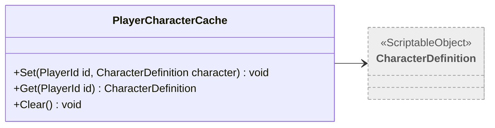

# PlayerCharacterCache

> Plain C# map from `PlayerId` to the character assigned to that player (views keep one each).

**Módulo:** [[Modulo UI|UI]] · **Namespace:** `AlienFarms.UI` · **Archivo:** `Assets/Scripts/UI/PlayerCharacterCache.cs`

## Diagrama

## Usa
[[CharacterDefinition]], [[PlayerId]]

## Usado por
[[ConnectionStatusView]], [[MatchResultsView]], [[PauseMenuView]]
