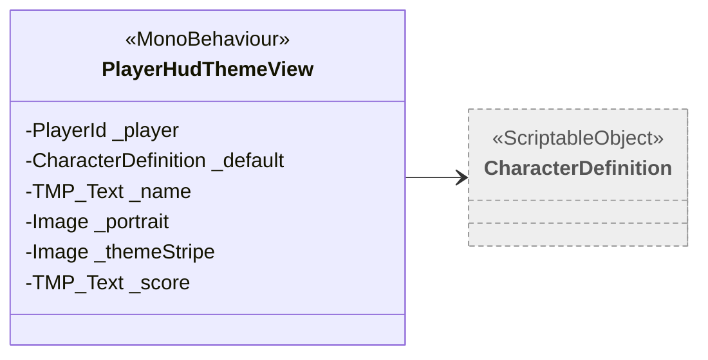

# PlayerHudThemeView

> Styles one player's HUD block with its character: name, portrait and theme colors. The score number itself is written by `ScoreView`; this view only tints it. Applied once per character assignment.

**Módulo:** [[Modulo UI|UI]] · **Namespace:** `AlienFarms.UI` · **Archivo:** `Assets/Scripts/UI/PlayerHudThemeView.cs`

## Hereda / implementa
`MonoBehaviour`

## Diagrama

## Usa
[[CharacterDefinition]], [[CharacterTheme]], [[GameEvents]], [[PlayerId]]

## Eventos que escucha
[[Eventos GameEvents#OnPlayerCharacterAssigned|OnPlayerCharacterAssigned]], [[Eventos GameEvents#OnPlayerLeft|OnPlayerLeft]]
