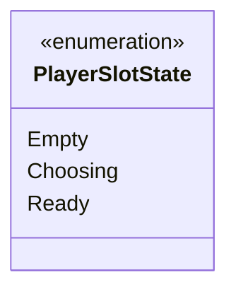

# PlayerSlotState

> Status of one player's slot on the character select screen.

**Módulo:** [[Modulo UI|UI]] · **Namespace:** `AlienFarms.UI` · **Archivo:** `Assets/Scripts/UI/PlayerSlotState.cs`

## Diagrama

## Valores
`Empty`, `Choosing`, `Ready`

## Usado por
[[CharacterSelectView]], [[MenuFlowController]], [[OnlineSeatView]], [[PlayerSlotStatusView]]
