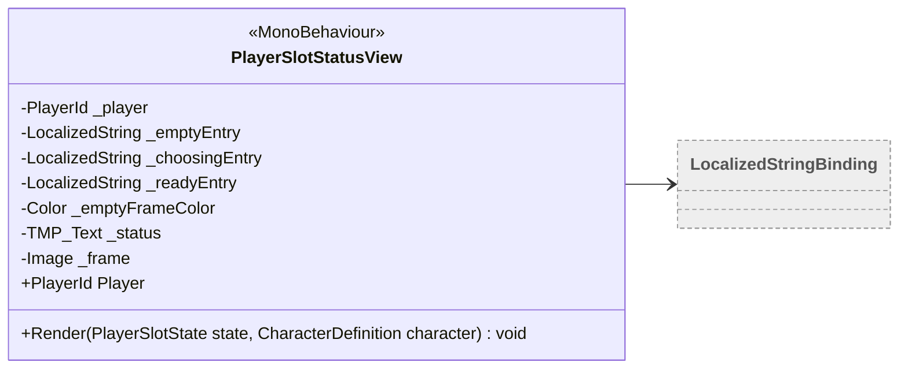

# PlayerSlotStatusView

> One player's status on the character select screen ("press to join" / "choosing" / "ready"), with the frame tinted by the hovered character's Theme.Primary. Text is only rewritten when the state changes.

**Módulo:** [[Modulo UI|UI]] · **Namespace:** `AlienFarms.UI` · **Archivo:** `Assets/Scripts/UI/PlayerSlotStatusView.cs`

## Hereda / implementa
`MonoBehaviour`

## Diagrama

## Usa
[[CharacterDefinition]], [[LocalizationKeys]], [[LocalizedStringBinding]], [[PlayerId]], [[PlayerSlotState]]

## Usado por
[[CharacterSelectView]]
