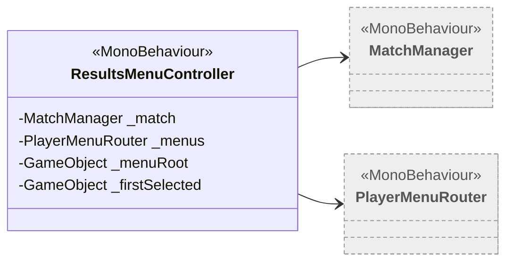

# ResultsMenuController

> Gives the results menu to the winner (Player 1 on a draw) once the match accepts a rematch (`MatchManager.IsRematchReady`, the same clock that gates the rematch), so a button held at the end of the round does not click it. Handed to the other player if the owner loses its device; released when leaving Results.

**Módulo:** [[Modulo UI|UI]] · **Namespace:** `AlienFarms.UI` · **Archivo:** `Assets/Scripts/UI/ResultsMenuController.cs`

## Hereda / implementa
`MonoBehaviour`

## Diagrama

## Usa
[[GameEvents]], [[MatchManager]], [[MatchPhase]], [[MatchResult]], [[PlayerId]], [[PlayerMenuRouter]]

## Eventos que escucha
[[Eventos GameEvents#OnMatchEnded|OnMatchEnded]], [[Eventos GameEvents#OnMatchPhaseChanged|OnMatchPhaseChanged]], [[Eventos GameEvents#OnPlayerDeviceLost|OnPlayerDeviceLost]], [[Eventos GameEvents#OnPlayerDeviceRegained|OnPlayerDeviceRegained]]
