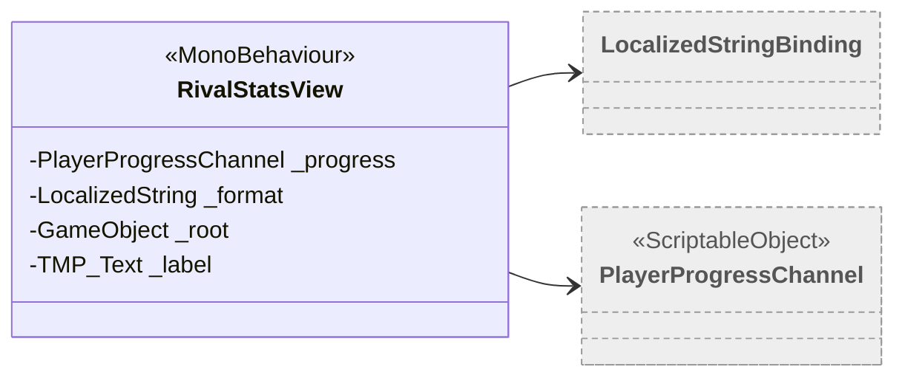

# RivalStatsView

> The rival's public stats in the online room ("Rival: {0} matches · {1} W · {2} D · {3} L"), read from the `PlayerProgressChannel`. Hidden while the channel has no rival stats. Redraws only when the channel changes (or the format resolves); TMP formats the numbers without allocating.

**Módulo:** [[Modulo UI|UI]] · **Namespace:** `AlienFarms.UI` · **Archivo:** `Assets/Scripts/UI/RivalStatsView.cs`

## Hereda / implementa
`MonoBehaviour`

## Diagrama

## Usa
[[LocalizationKeys]], [[LocalizedStringBinding]], [[PlayerProgressChannel]], [[PlayerStatsSummary]]
