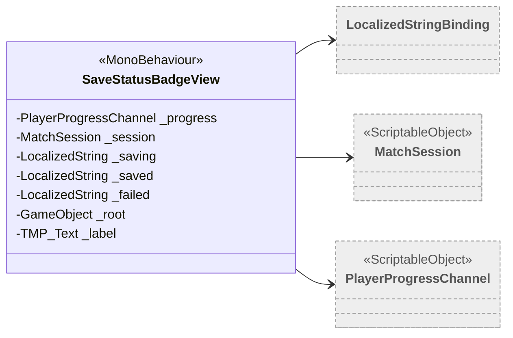

# SaveStatusBadgeView

> Cloud save badge on the results panel: "Saving… / Progress saved / Could not save (will retry)". Visible only in online matches and while the `PlayerProgressChannel` reports a save status other than Idle. Redraws only when the channel changes (or a string resolves), never per frame.

**Módulo:** [[Modulo UI|UI]] · **Namespace:** `AlienFarms.UI` · **Archivo:** `Assets/Scripts/UI/SaveStatusBadgeView.cs`

## Hereda / implementa
`MonoBehaviour`

## Diagrama

## Usa
[[GameMode]], [[LocalizationKeys]], [[LocalizedStringBinding]], [[MatchSession]], [[Mode]], [[PlayerProgressChannel]], [[PlayerProgressSaveStatus]]
