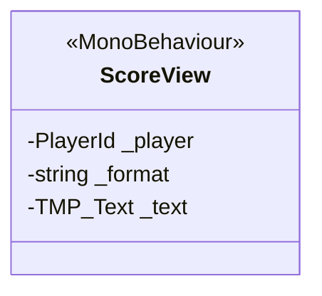

# ScoreView

> Shows one player's score. Updated only on score changes.

**Módulo:** [[Modulo UI|UI]] · **Namespace:** `AlienFarms.UI` · **Archivo:** `Assets/Scripts/UI/ScoreView.cs`

## Hereda / implementa
`MonoBehaviour`

## Diagrama

## Usa
[[GameEvents]], [[PlayerId]]

## Eventos que escucha
[[Eventos GameEvents#OnScoreChanged|OnScoreChanged]]
