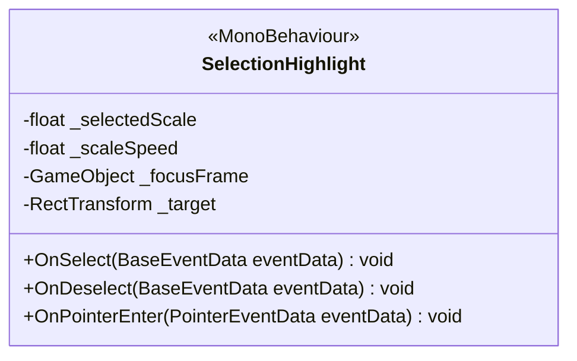

# SelectionHighlight

> Focus feedback for a menu button: shows a focus frame and scales up while selected. Hovering with the mouse selects the button (if interactable), so mouse and gamepad/keyboard share one focus. Animates with unscaled time so it works while the game is paused.

**Módulo:** [[Modulo UI|UI]] · **Namespace:** `AlienFarms.UI` · **Archivo:** `Assets/Scripts/UI/SelectionHighlight.cs`

## Hereda / implementa
`MonoBehaviour`, `ISelectHandler`, `IDeselectHandler`, `IPointerEnterHandler`

## Diagrama

