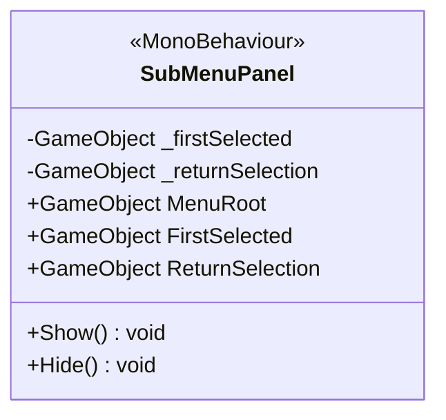

# SubMenuPanel

> A sub-menu opened from a parent menu (Options, How to play...). Lives on the panel root itself: showing or hiding it toggles this GameObject. The parent controller scopes the owner's event system to `MenuRoot`.

**Módulo:** [[Modulo UI|UI]] · **Namespace:** `AlienFarms.UI` · **Archivo:** `Assets/Scripts/UI/SubMenuPanel.cs`

## Hereda / implementa
`MonoBehaviour`

## Diagrama

## Usado por
[[MenuFlowController]], [[PauseController]]
