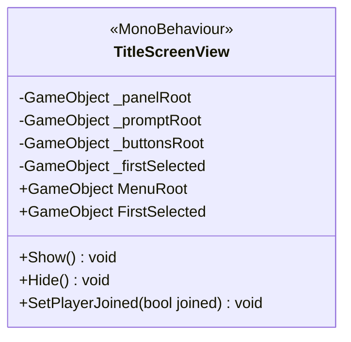

# TitleScreenView

> Title screen panel: shows the "press to start" prompt until the first player joins, then the menu buttons. Lives on an always-active object and toggles `_panelRoot`. Buttons are wired in the scene.

**Módulo:** [[Modulo UI|UI]] · **Namespace:** `AlienFarms.UI` · **Archivo:** `Assets/Scripts/UI/TitleScreenView.cs`

## Hereda / implementa
`MonoBehaviour`

## Diagrama

## Usado por
[[MenuFlowController]]
