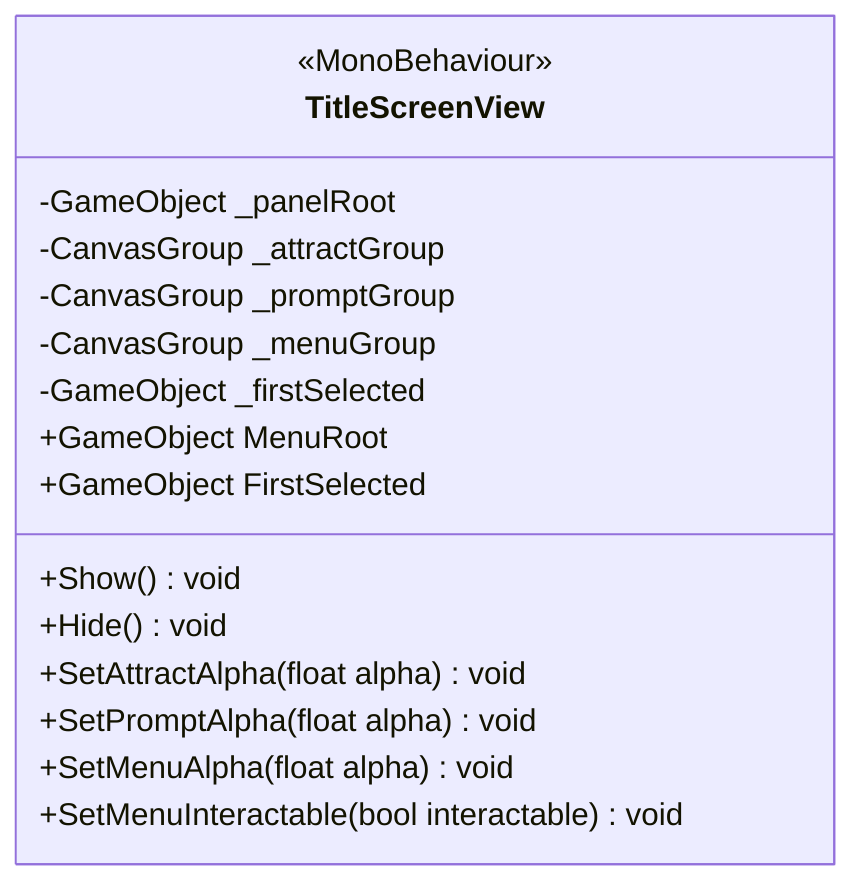

# TitleScreenView

> Applies title group visibility and input settings from the intro director.

**Módulo:** [[Modulo UI|UI]] · **Namespace:** `AlienFarms.UI` · **Archivo:** `Assets/Scripts/UI/TitleScreenView.cs`

## Hereda / implementa
`MonoBehaviour`

## Diagrama

## Usado por
[[MenuFlowController]], [[TitleIntroDirector]]
