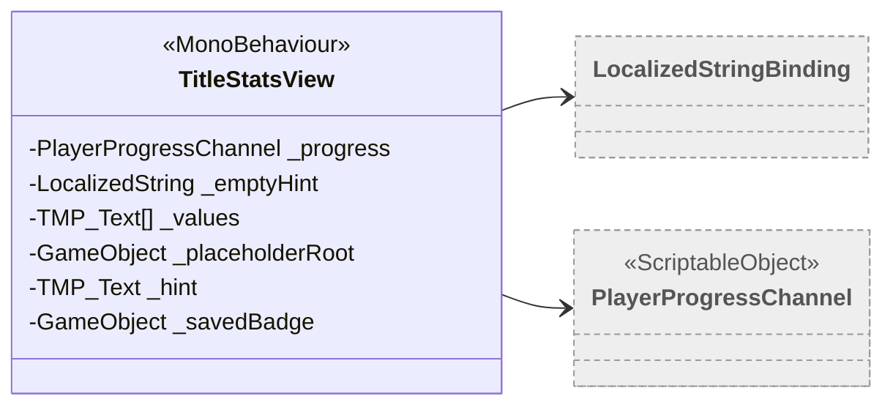

# TitleStatsView

> Lifetime stats on the title screen, read from the `PlayerProgressChannel`. Shows a dash and a hint until stats are loaded (the cloud save service writes them from task 2.8). Redraws only when the channel changes.

**Módulo:** [[Modulo UI|UI]] · **Namespace:** `AlienFarms.UI` · **Archivo:** `Assets/Scripts/UI/TitleStatsView.cs`

## Hereda / implementa
`MonoBehaviour`

## Diagrama

## Usa
[[LocalizationKeys]], [[LocalizedStringBinding]], [[PlayerProgressChannel]], [[PlayerProgressSaveStatus]], [[PlayerStatsSummary]]
