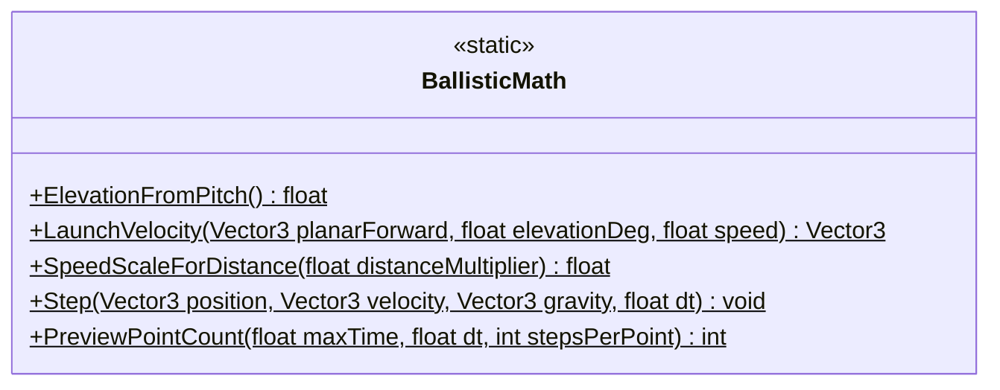

# BallisticMath

> Pure ballistic helpers shared by the throw and its preview. `Step` integrates exactly like PhysX (semi-implicit Euler), so a preview stepped with Time.fixedDeltaTime matches an undamped Rigidbody.

**Módulo:** [[Modulo Utilities|Utilities]] · **Namespace:** `AlienFarms.Utilities` · **Archivo:** `Assets/Scripts/Utilities/BallisticMath.cs`

## Diagrama

## Usado por
[[PlayerAim]], [[ThrowTrajectoryView]]
