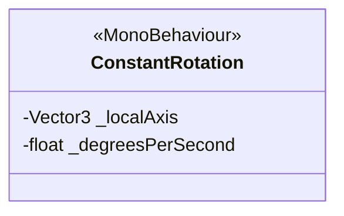

# ConstantRotation

> Spins its transform around a local axis at a constant rate (windmill blades, props). Purely visual: not networked, every machine rotates it locally.

**Módulo:** [[Modulo Utilities|Utilities]] · **Namespace:** `AlienFarms.Utilities` · **Archivo:** `Assets/Scripts/Utilities/ConstantRotation.cs`

## Hereda / implementa
`MonoBehaviour`

## Diagrama

