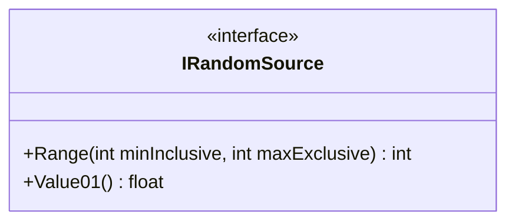

# IRandomSource

> Injectable random number source, so pure logic can be seeded and tested deterministically (never touches the global UnityEngine.Random state).

**Módulo:** [[Modulo Utilities|Utilities]] · **Namespace:** `AlienFarms.Utilities` · **Archivo:** `Assets/Scripts/Utilities/IRandomSource.cs`

## Derivados / implementaciones
[[SystemRandomSource]]

## Diagrama

## Usado por
[[AnimalSfxPlayer]], [[AudioVariation]], [[BombPlacement]], [[BombSfxPlayer]], [[BombSpawnSchedule]], [[BombSpawner]], [[CharacterSelectSfxPlayer]], [[MatchStatusSfxPlayer]], [[ObstacleField]], [[ObstacleLayoutPlanner]], [[OnlineSessionSfxPlayer]], [[SfxVoicePool]], [[SystemRandomSource]]
