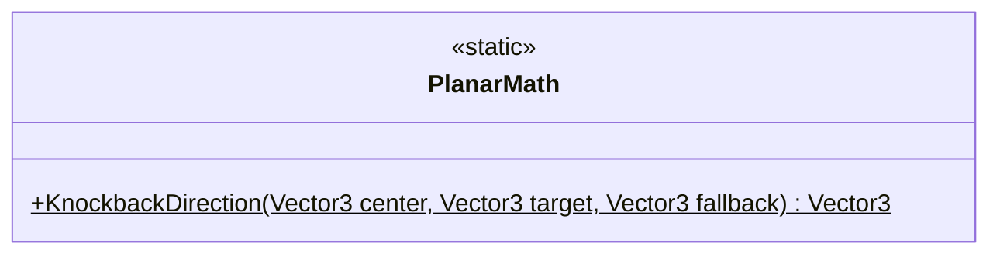

# PlanarMath

> Pure geometric helpers on the horizontal (XZ) plane.

**Módulo:** [[Modulo Utilities|Utilities]] · **Namespace:** `AlienFarms.Utilities` · **Archivo:** `Assets/Scripts/Utilities/PlanarMath.cs`

## Diagrama

## Usado por
[[PlayerStunReceiver]]
