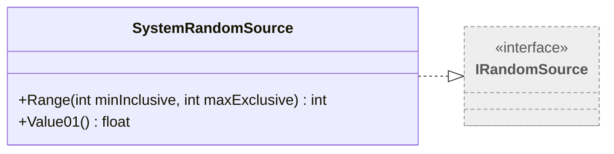

# SystemRandomSource

> `IRandomSource` backed by its own `System.Random`: the same seed always yields the same sequence, independently of anything else using UnityEngine.Random.

**Módulo:** [[Modulo Utilities|Utilities]] · **Namespace:** `AlienFarms.Utilities` · **Archivo:** `Assets/Scripts/Utilities/SystemRandomSource.cs`

## Hereda / implementa
[[IRandomSource]]

## Diagrama

## Usa
[[IRandomSource]]

## Usado por
[[AnimalSfxPlayer]], [[BombSfxPlayer]], [[BombSpawner]], [[CharacterSelectSfxPlayer]], [[MatchStatusSfxPlayer]], [[ObstacleField]], [[OnlineSessionSfxPlayer]]
