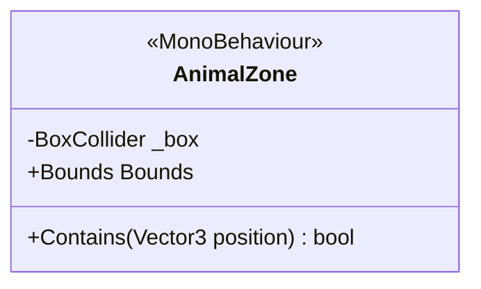

# AnimalZone

> Central area where animals live. Exposes the world-space bounds of its BoxCollider so animals can be confined to it. Animals receive plain `UnityEngine.Bounds` and never depend on this type.

**Módulo:** [[Modulo Zones|Zones]] · **Namespace:** `AlienFarms.Zones` · **Archivo:** `Assets/Scripts/Zones/AnimalZone.cs`

## Hereda / implementa
`MonoBehaviour`

## Diagrama

## Usa
[[ZoneBounds]]

## Usado por
[[AnimalSpawner]], [[BombSpawner]], [[ObstacleField]]
