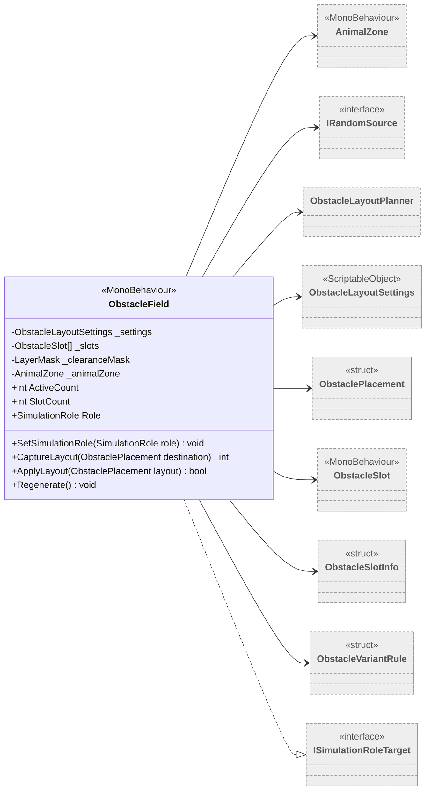

# ObstacleField

> Scene composition root of the random obstacles of the Animal Zone. Holds the scene-placed `ObstacleSlot`s and, on `Regenerate`, asks `ObstacleLayoutPlanner` which slots get which variant and yaw, then toggles the pre-instantiated children (no Instantiate/Destroy, no positions moved). The first layout is rolled in Awake, before the animal spawner's Start populates the zone. As a `SimulationRole.Replica` it never rolls a layout: the authority's one is applied with `ApplyLayout` (captured there with `CaptureLayout`).

**Módulo:** [[Modulo Zones|Zones]] · **Namespace:** `AlienFarms.Zones` · **Archivo:** `Assets/Scripts/Zones/ObstacleField.cs`

## Hereda / implementa
`MonoBehaviour`, [[ISimulationRoleTarget]]

## Diagrama

## Usa
[[AnimalZone]], [[IRandomSource]], [[ISimulationRoleTarget]], [[LayerNames]], [[ObstacleLayoutPlanner]], [[ObstacleLayoutSettings]], [[ObstaclePlacement]], [[ObstacleSlot]], [[ObstacleSlotInfo]], [[ObstacleVariant]], [[ObstacleVariantData]], [[ObstacleVariantRule]], [[ObstacleWeightEntry]], [[SimulationRole]], [[SystemRandomSource]]

## Usado por
[[MatchManager]], [[NetworkMatchState]], [[OnlineMatchBootstrap]]
