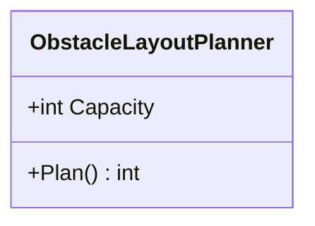

# ObstacleLayoutPlanner

> Pure obstacle layout picker (no Unity objects, no allocations after construction, EditMode-testable). Decides which slots get an obstacle, which variant and which yaw. Mirror pairs are placed as one unit (both or none, same variant, mirrored yaw) so the layout is fair for both players.

**Módulo:** [[Modulo Zones|Zones]] · **Namespace:** `AlienFarms.Zones` · **Archivo:** `Assets/Scripts/Zones/ObstacleLayoutPlanner.cs`

## Diagrama

## Usa
[[IRandomSource]], [[ObstaclePlacement]], [[ObstacleSlotInfo]], [[ObstacleVariantRule]]

## Usado por
[[ObstacleField]]
