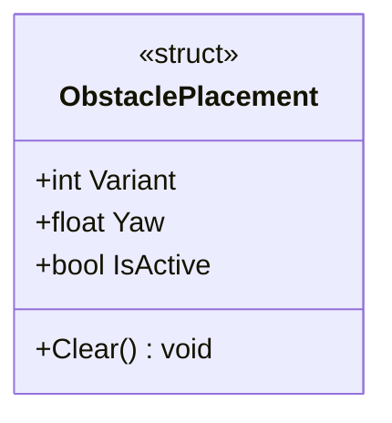

# ObstaclePlacement

> Planner output for one slot: chosen table variant (-1 = empty) and yaw in degrees.

**Módulo:** [[Modulo Zones|Zones]] · **Namespace:** `AlienFarms.Zones` · **Archivo:** `Assets/Scripts/Zones/ObstaclePlacement.cs`

## Diagrama

## Usado por
[[ObstacleField]], [[ObstacleLayoutPlanner]]
